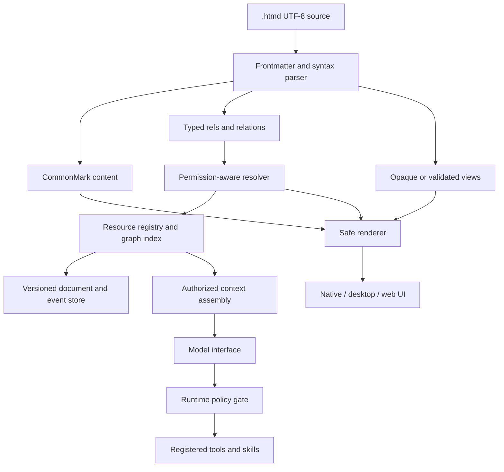

# Reference architecture and host integration

HTMD is a **content format** with explicitly optional runtime services. It is not a filesystem, a database engine, a scripting environment, a transport, or an agent harness.

## Layers and responsibilities

| Layer | Responsibility | Explicitly not responsible for |
| --- | --- | --- |
| Source | Portable authored truth or claims | Controlling permissions |
| Parser | Syntax/metadata/semantic extraction | Browsing, executing, model inference |
| Graph index | Fast traversal of directed relations | Deciding whether claims are true |
| Resolver | Resolve stable IDs subject to policy | Silently rewriting references |
| Store | Revisions, append-only events, provenance | Defining HTMD syntax |
| Renderer | Markdown/native UI and sanitized views | Granting tool authority |
| Host runtime (optional) | Context budgeting, action approval, audit | Treating document text as privileged instructions |

## Example data flow

1. A user opens `res://examples/device` on a phone.
2. The resolver checks the user's authorization and loads a source snapshot from the local or synchronized store.
3. The parser extracts the Markdown and `contains → res://examples/sensor` edge; the UI presents the document and related entities.
4. If a client needs background information, it requests `mem://examples/requirements` through a separate, policy-aware context assembly layer.
5. If the host initiates a privileged action, the runtime checks capability grants and arguments independently of any `<tool />` reference.
6. New observed events are appended as new immutable records, then replicated without overwriting prior event content.

## Identity and storage

- **Identity:** logical URI, not disk path. The registry maps IDs to versions and locations.
- **Source of record:** the original `.htmd` bytes and their revisions. Indexes can be rebuilt.
- **Graph:** derived index of explicit edges; inferred edges must be marked and never silently promoted to asserted edges.
- **Memory retrieval:** retrieve a small, authorized neighborhood or summary rather than loading all linked documents.
- **Sync:** version-aware, preserves event identities. HTMD does not prescribe CRDT, GraphQL, Git, or a server architecture.
- **Offline operation:** resolvers can mark unavailable remote content as unresolved/offline while retaining its stable ID.

## Example storage pattern (non-normative)

- Keep `.htmd` records in a content-addressed or revisioned store.
- Index IDs, document type, named entities, outgoing edges, full-text content, and source provenance in SQLite.
- Write events through an append-only API with ID uniqueness and immutable-blob checks.
- Use a local encrypted database if the content is sensitive; encryption is a storage decision, not HTMD syntax.
- Maintain per-document revision hashes, synchronization vectors or comparable conflict metadata.
- Keep ephemeral conversation summaries in mutable memory documents; do **not** retroactively modify event records to match a summary.

## Design boundary

An `action` document describes an action. A `<tool>` element names a capability. Neither constitutes an executable workflow. A host application may translate permitted intentions into separately validated tool invocations through its own planning and policy layers. This prevents knowledge documents from becoming remote command scripts.
