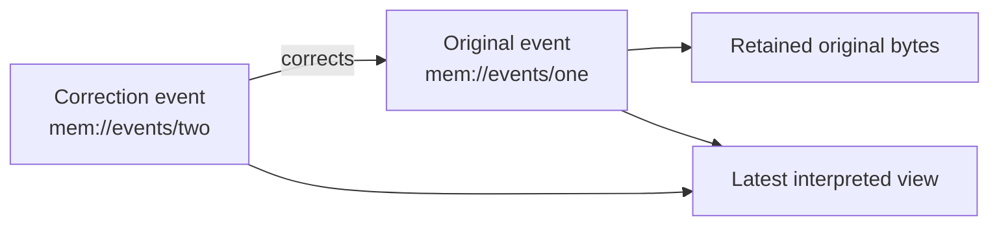

# Data model and memory semantics

This explanatory guide expands the normative definitions in [the HTMD specification](../SPECIFICATION.md).

## A document is not an entire object database

A `.htmd` file stores human-readable text and optional semantic claims. A host registry can map a stable logical ID to its document location and revision. The graph index is a **derived view** of those source documents.

```text
Source record: res://examples/device
  text: "A modular device with a replaceable sensor module"
  relation: contains → res://examples/sensor
  relation: depends-on → res://examples/controller (hypothetical)

Source record: res://examples/sensor
  text: "Replaceable sensor module"
```

The index can answer questions such as *which components are inside the device?* without loading entire project folders. It cannot silently assume the inverse of `contains`, that the sensor exists, or that a hypothetical dependency is confirmed.

## Fact, hypothesis, thought and event

| Category | Interpretation | Requirements |
| --- | --- | --- |
| `fact` | Source-backed assertion | A stable ID and nonempty evidence URIs |
| `hypothesis` | Tentative proposition | Stable ID; remains unverified |
| `thought` | Interpretation or opinion | Stable ID; should carry clear authorship in an application |
| `event` | Claim that an occurrence took place | Stable ID, actor, occurred/recorded times, append-only storage |

A sourced fact may be incorrect or out of date. Evidence is **traceability**, not automatic verification. A thought or hypothesis may later support a new fact but is not retroactively transformed into one.

## Correction lifecycle



A history-aware client should distinguish **what was recorded** from **what currently appears most accurate**. A reader may present the latest correction prominently, but must preserve original event identity and audit history.

## Revision versus event time

- `occurred_at` means when an event reportedly took place.
- `recorded_at` means when the event was recorded; it is not necessarily when every device synchronized the record.
- `htmd: "0.1"` means the syntax version, not a document version.
- A store may assign revisions or hashes out of band; such metadata must not change the original event bytes.
- Different devices may have different local replicas while offline. A new revision is not necessarily more truthful solely because it was synchronized later.

## Context assembly

A `<context mode="summary">` node suggests relevant background. Context assembly should:

1. Check caller and target access rights.
2. Verify identity and revision of the retrieved resource.
3. Select relevant spans/summaries under a token budget.
4. Label the source and epistemic type (`fact`, `hypothesis`, etc.).
5. Avoid recursively expanding every reference or letting retrieved text override agent policy.

The exact retrieval algorithm is not in HTMD. This separation lets implementations change models, retrieval engines, or storage systems without rewriting documents.
